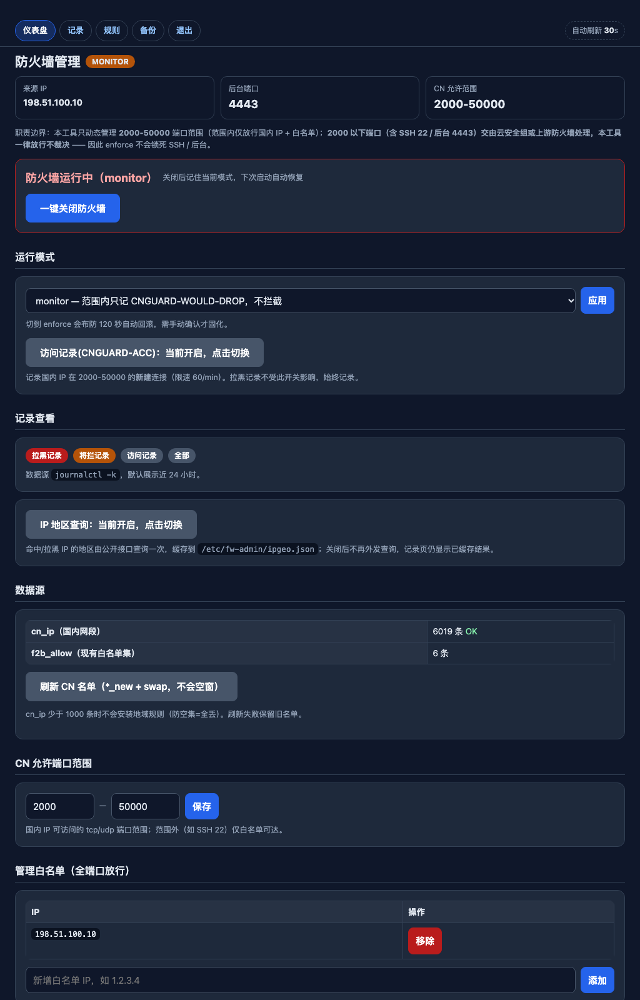
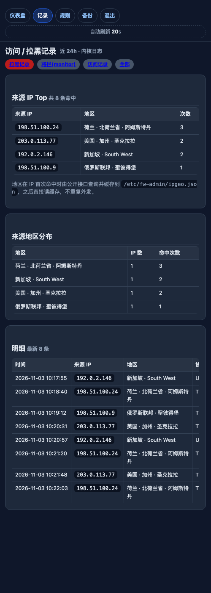

# fwSeaOut

**海外 IP 拦截** —— 基于 `ipset` + `iptables` 的国家/地区动态防火墙，带 Web 管理、自动回滚与规则自愈。

一套安装脚本 + 一个纯标准库 Python 程序，从零部署到任意 Linux（systemd）服务器：只把业务端口开放给国内 IP，范围外端口一律不裁决，交给云安全组或上游防火墙。

---

## 为什么是它

云厂商安全组通常只能按 IP/CIDR 放行，无法表达“只允许中国境内来源”。本项目的做法是：

- 用公开的中国 IPv4 前缀表维护 `ipset cn_ip`（约 6000 条，每周自动刷新）；
- 用 `iptables` 在指定端口范围内做“非国内来源则丢弃”；
- 用 `monitor` 模式先只记录不丢弃，确认没有误伤后再切 `enforce`；
- 切 `enforce` 时强制进入 120 秒自动回滚窗口，避免一次误配置把业务和 SSH 全锁死。

它不是 WAF，也不是云安全组的替代品；它只解决“端口范围内按国家放行”这一件事。





## 特性

| 能力 | 说明 |
| --- | --- |
| 三种模式 | `disabled`（完全不挂载）/ `monitor`（只记日志）/ `enforce`（记录并丢弃） |
| 自动回滚 | 切到 `enforce` 后 120 秒内未在页面确认，自动降回 `monitor` |
| 规则自愈 | 每 60 秒检查挂载；Docker 重启重建 `DOCKER-USER` 也能自动补回 |
| 空集防呆 | `cn_ip` 少于 1000 条时拒绝安装地域规则，`enforce` 下自动降级 |
| 安全边界 | 只管理 `cn_allowed_range` 端口范围，范围以下（SSH 等）一律放行不裁决 |
| 白名单 | 管理 IP 全端口放行；`f2b_allow` ipset 与私网/关键源恒放行 |
| 媒体豁免 | RTP/UDP 段可配置为永不按来源 IP 过滤 |
| 日志查看 | 从 `journalctl -k` 解析访问 / 将拦 / 已拦三类记录，页面按来源 IP 聚合 Top |
| IP 地区 | 首次命中/拉黑时用公开接口查询地区并落盘缓存，记录页显示地区列与地区分布；渲染时不外发请求 |
| 手机适配 | 响应式 Web 管理页，自动刷新倒计时在填写表单时暂停 |
| 零第三方依赖 | 只有 Python 标准库 + `iptables`/`ipset` |

## 工作原理

```
                         ┌──────────────────────────── 入站包 ────────────────────────────┐
                         │                                                                │
              ┌──────────▼──────────┐                                  ┌──────────────────▼─────────────┐
              │ 宿主端口 (INPUT)     │                                  │ Docker 发布端口 (FORWARD)       │
              │ SSH / 管理后台 / ... │                                  │ 先过 DNAT，再进 DOCKER-USER     │
              └──────────┬──────────┘                                  └──────────────────┬─────────────┘
                         │                                                                │
                  CN_GUARD (第 1 条)                                          fail2ban 链 / F2B-GEO (可选)
                         │                                                                │
                         └──────────────────────────┬─────────────────────────────────────┘
                                                    ▼
                                    CN_GUARD（末尾追加，不 flush 其他链）
                          1. lo / ESTABLISHED            → RETURN
                          2. f2b_allow ipset             → RETURN
                          3. admin_ips / 恒放行网段       → RETURN
                          4. RTP/UDP 段                  → RETURN
                          5. 国内 IP + 管理端口范围       → RETURN（可选记 CNGUARD-ACC）
                          6. 其余 + 管理端口范围          → CN_VERDICT
                          7. 其他端口                     → RETURN（交给云安全组/上游）
                                                    │
                                     CN_VERDICT（按模式）
                                  enforce : LOG CNGUARD-DROP + DROP
                                  monitor : LOG CNGUARD-WOULD-DROP + RETURN
                                  disabled: RETURN
```

关键点：

- **范围之外不裁决**。`cn_allowed_range` 默认 `2000:50000`；`< 2000` 的端口（如 SSH 22、Web 管理 4443）永远 RETURN，所以 `enforce` 不可能锁死 SSH 或管理后台。
- **Docker 端口看的是 DNAT 之后的端口**。发布 `19080:80` 时，`--dport` 匹配到的是容器的 `80`；容器监听端口应尽量与宿主端口一致，否则会出现“绕过地域规则”的盲区（见下文）。
- **重建链时先 flush = fail-open**。重建的毫秒级窗口内所有包按正常路径放行，绝不因为链为空而全丢。
- **`DOCKER-USER` 追加在末尾**。不与现有 `f2b-sip`、`F2B-GEO` 抢位置，也不会 flush `IN_BT` 等第三方链。

## 环境要求

- Linux，systemd（Debian/Ubuntu、RHEL/CentOS/Rocky/Alma、openSUSE 等）
- root 权限
- `iptables`、`ipset`、`python3 >= 3.6`、`curl`
- 可选：Docker（容器发布端口）、fail2ban（封禁集守卫）

> `iptables-nft` 与 `iptables-legacy` 不要混用。Debian/Ubuntu 可用
> `update-alternatives --set iptables /usr/sbin/iptables-legacy` 统一后端；
> 已用 `nft` 直接管理规则的环境请先确认 `ipset` 是否可用。

## 快速安装

```bash
git clone https://github.com/REsab/fwSeaOut.git
cd fwSeaOut
sudo ./install.sh --admin-ip 203.0.113.10
```

`--admin-ip` 是**唯一能访问 Web 管理页的来源 IP**（同时全端口放行），通常填你办公网的固定出口 IP。不填时脚本会取当前 SSH 来源 IP。

安装完成后：

- 程序：`/opt/fw-admin/fw_admin.py`
- 配置：`/etc/fw-admin/config.json`（权限 600）
- 名单：`/etc/f2b/cn-v4.list`、`/etc/f2b/allow-v4.list`
- 服务：`fw-admin.service`（开机自启）
- 定时器：`f2b-geo-refresh.timer`（每周刷新 CN 前缀）

初次安装默认 `mode=disabled`：服务已启动，但不挂载任何过滤规则，对现网零影响。

### 安装参数

| 参数 | 默认 | 说明 |
| --- | --- | --- |
| `--admin-ip IP[,IP...]` | 当前 SSH 来源 | Web 白名单 + 全端口放行 |
| `--range LO:HI` | `2000:50000` | 国内 IP 允许的 tcp/udp 端口范围 |
| `--mode disabled\|monitor` | `disabled` | 初始模式；`enforce` 只能装好后从 Web 切换 |
| `--web-port PORT` | `4443` | 管理页端口 |
| `--web-bind ADDR` | `0.0.0.0` | 管理页监听地址 |
| `--rollback SECONDS` | `120` | enforce 自动回滚窗口 |
| `--rtp LO:HI[,LO:HI]` | 空 | 永不按 IP 过滤的 UDP 段（RTP 媒体） |
| `--always-allow CIDR,...` | 私网/回环/CGNAT | 恒放行网段 |
| `--password PW` | 交互输入 | 不建议命令行传密码（会进 shell history） |
| `--non-interactive` | 关 | 不提示任何输入 |
| `--skip-deps` | 关 | 不自动安装依赖 |
| `--dry-run` | 关 | 只打印将执行的动作 |
| `--with-sip-geo` | 关 | 额外安装 SIP/RTP 地域封禁链 `F2B-GEO` |
| `--sip-ports A:B[ C:D]` | `5060:5091` | SIP 端口段 |
| `--geo-rtp-ports A:B..` | `10000:10500` | 媒体端口段 |
| `--with-fail2ban-guard` | 关 | 每分钟把 fail2ban 封禁集重新挂回 `DOCKER-USER` |
| `--jail NAME` | `freeswitch-sip` | fail2ban jail 名 |

示例：

```bash
# 只放行国内访问 1024-65535，先观察不拦
sudo ./install.sh --admin-ip 203.0.113.10 --range 1024:65535 --mode monitor

# Docker + FreeSWITCH：加装 SIP 地域封禁与 fail2ban 守卫
sudo ./install.sh --admin-ip 203.0.113.10,198.51.100.20 \
  --rtp 10000:10200,10300:10500 \
  --with-sip-geo --with-fail2ban-guard

# 非交互（密码自动生成并打印一次）
sudo ./install.sh --admin-ip 203.0.113.10 --non-interactive
```

重装/升级是幂等的：已有密码、`mode`、名单都会保留；显式传 `--mode` 才会覆盖模式。

## 首次使用：从观察到拦截

1. **`disabled`（安装后默认）**：不挂规则。先登录 Web，确认 `cn_ip` 条数正常（几千条）。
2. **`monitor`**：范围内海外来源只记录 `CNGUARD-WOULD-DROP`，不丢包。观察 24 小时，看“将拦记录”里是否有不该出现的来源（境外中继、CDN、合作方回调等）。
3. **`enforce`**：真正丢弃。切换后进入 120 秒回滚窗口：
   - 新开终端验证 SSH、业务、API 是否正常；
   - 回到 Web 点“确认生效（取消自动回滚）”固化；
   - 超时未确认会自动降回 `monitor`，不会一断到底。
4. **紧急关闭**：Web 顶部“一键关闭防火墙”会摘除所有挂载并记住当前模式，下次启动自动恢复。
   CLI 等价命令：`fw_admin.py disable`。

> 任何会丢包的变更，都应先 `monitor` 观察。

## Web 管理

访问 `http://<服务器IP>:4443`，仅 `admin_ips` 与服务器 localhost 可访问。

- 仪表盘：模式、来源 IP、CN 允许范围、回滚倒计时、开关、模式切换、白名单、端口范围
- 记录：拉黑 / 将拦 / 访问 / 全部，近 24 小时，按来源 IP 聚合 Top，并显示 IP 地区与地区分布
- 规则：dry-run 打印当前配置将要执行的完整 `iptables` 命令
- 备份：导出当前 `iptables-save`
- 自动刷新：30/20 秒倒计时；输入框聚焦或有未提交改动时暂停，避免打断操作
- 手机：单列布局、表格横向滚动、触控尺寸按钮

HTTP 明文，且密码使用加盐 SHA-256（非慢哈希）。生产环境建议：

```bash
# 本机开 SSH 隧道，只从 127.0.0.1 访问（服务端对 localhost 永久放行）
ssh -L 4443:127.0.0.1:4443 root@<服务器IP>
# 然后浏览器打开 http://127.0.0.1:4443
```

或在前置 Nginx/Caddy 上做 TLS 与额外鉴权。

## 配置文件

`/etc/fw-admin/config.json`：

| 键 | 说明 |
| --- | --- |
| `mode` | `disabled` / `monitor` / `enforce` |
| `last_mode` | 一键关闭前记住的模式 |
| `web_bind` / `web_port` | 管理页监听 |
| `admin_ips` | Web 白名单 + 全端口放行 |
| `cn_allowed_range` | `[lo, hi]`，国内 IP 允许的端口范围 |
| `always_allow_nets` | 恒放行网段（私网、内部交换等） |
| `rtp_udp_ranges` | `[[lo,hi], ...]`，UDP 永不按 IP 过滤 |
| `cn_ipset` / `allow_ipset` | ipset 名称，默认 `cn_ip` / `f2b_allow` |
| `guard_chain` / `verdict_chain` | 链名，默认 `CN_GUARD` / `CN_VERDICT` |
| `rollback_seconds` | enforce 自动回滚窗口 |
| `log_accepted` | 是否记录国内 IP 命中（`CNGUARD-ACC`） |
| `geo_enabled` | 是否调用公开接口查询命中 IP 的地区（默认开启） |
| `geo_api` | 批量查询接口，默认 `ip-api.com/batch`（失败自动回落 `ipwho.is`） |
| `geo_max_per_cycle` | 每轮最多查询的新 IP 数，默认 100（接口限速保护） |
| `cn_sources` | CN 前缀下载源 |

地区缓存独立落盘在 `/etc/fw-admin/ipgeo.json`（`0600`，成功结果保留 30 天，失败按指数退避重试）。只有源 IP 会发给第三方接口，不发送端口、目的地址或任何配置；不想要可关闭 `geo_enabled` 或点页面上的「IP 地区查询」开关。

修改配置后重启服务生效：

```bash
systemctl restart fw-admin
```

## CLI

```bash
python3 /opt/fw-admin/fw_admin.py <command>
```

| 命令 | 作用 |
| --- | --- |
| `serve` | 前台运行 Web（systemd 使用） |
| `apply` | 按当前配置应用一次（幂等） |
| `dry-run` | 打印将执行的 iptables/ipset 命令 |
| `revert` | 降为 `monitor` 并应用（回滚用） |
| `disable` | 设为 `disabled` 并摘除挂载 |
| `reload-cn` | 重新下载并原子替换 `cn_ip` |
| `geo <ip>...` | 查询 IP 地区并写入缓存 |
| `set-password` | 交互式改密码 |
| `watchdog <epoch>` | 内部使用：到点未确认则回滚 |

常用运维：

```bash
systemctl status fw-admin
journalctl -u fw-admin -f                 # 程序日志
journalctl -k --since -1h | grep CNGUARD  # 命中日志
iptables -S CN_GUARD
iptables -S DOCKER-USER
ipset list cn_ip | head
```

## 可选组件

### SIP/RTP 地域封禁（`--with-sip-geo`）

为 VoIP 场景准备的独立链 `F2B-GEO`，挂在 `DOCKER-USER` 末尾：

- 非国内来源访问 SIP 端口（默认 `5060:5091`，tcp+udp）→ DROP
- 非国内来源访问 RTP 段（默认 `10000:10500/udp`）→ DROP
- 先放行 `ESTABLISHED,RELATED` 与 `f2b_allow`

它和 `CN_GUARD` 互不依赖，可以只装其中一个。媒体端口一定要用 `--rtp` 或 `--geo-rtp-ports` 显式声明，否则单向语音很容易被误伤。

### fail2ban 封禁集守卫（`--with-fail2ban-guard`）

Docker 重启会把 `DOCKER-USER` 重建为空链，fail2ban 的 ipset 规则随之消失。`f2b-guard.timer` 每分钟检查并补回，逐条 `iptables -C` 判断，不会重复插入。

## 目录结构

```
fwSeaOut/
├── fw_admin.py                  # 主程序（Web + 规则引擎 + 自愈 + 回滚）
├── install.sh                   # 一键安装
├── uninstall.sh                 # 卸载（--purge 彻底清理）
├── config/config.example.json   # 配置样例
├── scripts/
│   ├── f2b-geo-load.sh          # 由名单重建 ipset（*_new + swap）
│   ├── f2b-geo-refresh.sh       # 下载并合并 CN 前缀表
│   └── f2b-guard.sh             # SIP 地域封禁 + fail2ban 守卫
├── systemd/                     # 单元模板（安装时替换路径）
└── docs/OPERATIONS.md           # 运维与排障手册
```

安装后的运行期目录：

| 路径 | 内容 |
| --- | --- |
| `/opt/fw-admin/fw_admin.py` | 主程序 |
| `/etc/fw-admin/config.json` | 配置（含密码哈希、session secret） |
| `/etc/fw-admin/fw_admin.log` | 程序日志 |
| `/etc/f2b/cn-v4.list` | 中国 IPv4 前缀表 |
| `/etc/f2b/allow-v4.list` | 恒放行来源 |
| `/etc/f2b-geo/env` | 脚本运行参数 |
| `/var/lib/f2b-geo/` | 下载缓存 |

## 升级

```bash
cd fwSeaOut
git pull
sudo ./install.sh --admin-ip <原参数>   # 或不带 --admin-ip，沿用配置里的白名单
```

安装器会保留已有密码、模式、名单；只替换程序与单元文件，然后重启服务。

## 卸载

```bash
sudo ./uninstall.sh            # 摘规则、停服务、删程序；保留配置和名单
sudo ./uninstall.sh --purge    # 连配置、名单、ipset 一起删
```

## 常见问题

**切到 enforce 后业务不通？**
等 120 秒自动回滚，或在 Web 点“一键关闭防火墙”。然后看“拉黑记录”里被丢弃的来源，把确需放行的 IP/CIDR 加进 `f2b_allow` 或 `admin_ips`，先回 `monitor` 复核。

**某个 Docker 端口从海外还能访问？**
检查发布映射是不是 `宿主端口:容器端口` 且两者不同。`iptables` 的 `--dport` 匹配 DNAT **之后**的容器端口，应让容器监听端口与宿主端口一致，或把容器端口纳入 `cn_allowed_range`。例如 `19080:80` 需要改成 `19080:19080`。

**`cn_ip` 是 0 条 / 地域规则不生效？**
名单没下载成功或不足 1000 条时代码会拒绝安装地域规则（防空集导致全丢）。执行：

```bash
/usr/local/sbin/f2b-geo-refresh.sh
ipset list cn_ip | grep entries
```

**重启 Docker 后规则消失？**
`fw-admin` 自带 60 秒自愈；fail2ban 相关规则需要 `--with-fail2ban-guard` 安装 `f2b-guard.timer`。

**和 firewalld / ufw 冲突？**
本工具只操作自定义链与 `DOCKER-USER`，不改 `INPUT` 默认策略，也不 flush 其他链。但 firewalld 重载可能清空 `iptables` 规则，建议在 firewalld 环境里把本服务放到 `fw-admin.service` 的 `After=firewalld.service`，并在 firewalld 变更后重启 `fw-admin`。

**端口范围以下的端口还暴露在外？**
这是设计取舍：本工具只裁决 `cn_allowed_range`。SSH、管理页、数据库等应通过云安全组/上游防火墙限制来源，或把它们纳入范围。

**为什么不用 nftables 直接写？**
为了兼容既有 `iptables` + `ipset` + fail2ban 环境。`iptables-nft` 后端同样可用。

## 安全说明

- Web 管理页是 **HTTP**，请用 SSH 隧道或前置 TLS 反代；不要直接暴露在公网。
- `admin_ips` 同时是 Web ACL 和全端口白名单，尽量只填固定出口 IP。
- 密码是加盐 SHA-256，不是 bcrypt/argon2；请使用长随机密码。
- 切换 `enforce` 前务必先 `monitor` 观察，并保留至少一条可用的带外管理通道（云控制台 VNC / 串口）。
- `--purge` 会删除配置与 ipset，其中 `cn_ip` 可能被其他工具复用，确认后再执行。

## License

[MIT](LICENSE)
